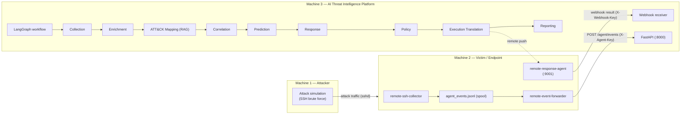
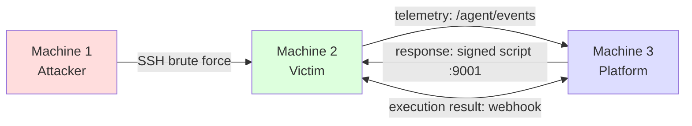
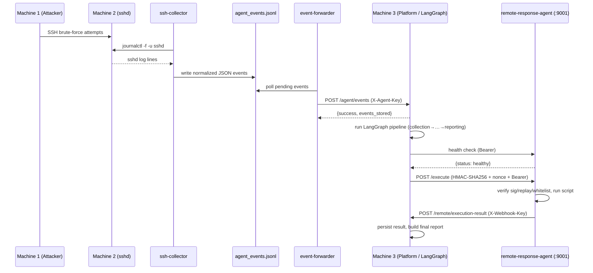

# Chapter 3 — System Architecture

This chapter describes the architecture of the **Agentic Threat Intelligence Platform** as it is actually implemented in the repository. Every technical detail below was verified against the source code, the Docker Compose files, the API definitions and the agent pipeline — nothing is hypothetical.

---

## 3.1 Global Architecture

### 3.1.1 Design principle

The platform inverts the cost curve of a classic SIEM. Instead of collecting data and letting a human analyst do all the reasoning, the platform delegates the reasoning to seven specialised AI agents that run inside a single **LangGraph** pipeline. Each agent is a node that reads a shared `InvestigationState` object, computes its own slice, and returns a partial update that LangGraph merges back into the state, so every downstream agent always sees full context of everything that happened upstream.

The pipeline is deliberately **linear** (`graph/workflow.py`):

```
START → collection → enrichment → mapping → correlation → prediction → response → execution_translation → reporting → END
```

Each node maps to one agent class (`agents/`), wired through thin wrappers in `graph/nodes.py`. All LLM reasoning goes through a single Groq client (`llm/groq_client.py`, model `llama-3.3-70b-versatile`) via a common `invoke_llm()` helper, so the provider can be swapped without touching the agents.

### 3.1.2 The role of the three machines

The end-to-end system spans three distinct machines:

| Machine | Role |
|---|---|
| **Machine 1 — Attacker** | Generates the simulated attack traffic (SSH brute force) against Machine 2. |
| **Machine 2 — Victim / Endpoint** | The targeted host. Runs Docker Compose with three containers: `remote-ssh-collector`, `remote-event-forwarder`, and `remote-response-agent`. Collects telemetry and executes approved mitigation actions. |
| **Machine 3 — AI Threat Intelligence Platform** | The analytical brain. Hosts the FastAPI service, the LangGraph agent pipeline, ChromaDB, Neo4j and the Groq LLM. Investigates events, predicts attacker behaviour and pushes response actions back to Machine 2. |

> Note: within the repository, the Management IP that connects the machines uses a private `100.x.x.x` (CGNAT / Tailscale) address, and the push client explicitly handles overlay-network edge cases. This is the channel over which Machine 3 reaches Machine 2 (and vice-versa).

### 3.1.3 Complete data flow

The complete flow requested for this chapter maps onto the implemented pipeline as follows:

```
 Telemetry ──► Collection ──► Enrichment ──► ATT&CK Mapping ──► Correlation ──► Prediction
                                                                                    │
 Reporting ◄── Feedback ◄── Execution ◄── Policy ◄── Response ◄────────────────────┘
```

- **Telemetry** — raw SSH auth events collected on Machine 2 (`remote-ssh-collector` tails `journalctl -u sshd` and writes normalized events).
- **Collection** (`collection_node`) — normalizes heterogeneous raw events into one event schema → `events`.
- **Enrichment** (`enrichment_node`) — extracts and scores IOCs (IPs / hashes / domains / URLs), querying AbuseIPDB and OTX → `iocs`.
- **ATT&CK Mapping** (`mapping_node`) — RAG-based semantic retrieval of MITRE ATT&CK techniques from ChromaDB, then an LLM picks the technique ID + confidence → `techniques`.
- **Correlation** (`correlation_node`) — groups isolated events and techniques into one campaign narrative → `campaign`.
- **Prediction** (`prediction_node`) — forecasts the attacker's likely next technique using attack-chain progressions → `prediction`.
- **Response** (`response_node`) — proposes response actions from a compact threat summary → `actions_taken`.
- **Policy** (`actions/policy.py`) — a deterministic, non-LLM gate classifies each proposed action as `auto_execute`, `pending_approval`, or `denied`.
- **Execution** (`execution_translation_node`) — translates approved actions into an executable bash script and (when enabled) pushes it to Machine 2.
- **Feedback** — the Machine 2 remote agent reports the execution result back to Machine 3 over a webhook.
- **Reporting** (`reporting_node`) — produces the final Markdown intelligence report including response outcomes.

### 3.1.4 Mermaid architecture diagram



---
## 3.2 Three-Machine Topology

### 3.2.1 Machine 1 — Attacker (attack simulation)

Machine 1 generates simulated attacker behaviour against Machine 2 by performing SSH authentication attempts (brute force against the sshd service of the victim). The telemetry collector on Machine 2 is what makes these attempts visible: the `remote-ssh-collector` regex-parses sshd log lines such as `Failed password for ... from ... port ...`, `authentication failure ... rhost=...`, and `Accepted password for ...`, turning them into normalized events (`auth_failed`, `auth_success`). The collected `data/` investigation memory also records Wazuh alert data on the same victim host, showing that the observed attack narrative (credential brute force) is representative of the scenario.

### 3.2.2 Machine 2 — Victim (Docker Compose)

Machine 2 is the targeted host and runs a standalone Docker Compose stack (`remote_agent/docker-compose.yml`, `network_mode: host`) with three services built from a common Python image:

| Service | Module | Responsibility |
|---|---|---|
| **remote-ssh-collector** | `remote_agent/ssh_collector.py` | Tails `journalctl -u sshd -f`, regex-parses auth lines, and appends normalized JSON events to the spool file `agent_events.jsonl`. |
| **remote-event-forwarder** | `remote_agent/forwarder.py` | Polls the spool file, batches events (default 100), POSTs them to the Machine 3 ingest endpoint, and persists a cursor so already-sent events are not duplicated. Failed batches are requeued locally for retry. |
| **remote-response-agent** | `remote_agent/app.py` | A FastAPI service on port **9001**. Receives signed response scripts from Machine 3, validates them (signature, replay window, action whitelist, forbidden-command scan, Bearer token), executes the bash script with `/bin/bash`, logs the execution, and posts the result back to Machine 3 over a webhook. |

The Dockerfile installs the system tools the response actions need (`iptables`, `iproute2`, `net-tools`, `procps`, `systemd`) and grants the `NET_ADMIN` / `SYS_ADMIN` capabilities needed for firewall operations. It has a volume for received scripts and logs, and an execution timeout (default 1800s).

### 3.2.3 Machine 3 — AI Threat Intelligence Platform

Machine 3 is the core of the system. It runs:

- **FastAPI REST API** (`app.py`) exposing: `/investigate`, `/investigate/file/{path}`, `/investigate/connector/{name}`, `/agent/events` (agent ingest), `/agent/latest`, `/remote/execution-result` (webhook), `/response/pending-actions` + decision endpoint, `/attack/search`, `/config`, `/health`, and `/connectors`.
- **LangGraph agent pipeline** (`graph/`) — the seven reasoning agents plus an execution-translation step.
- **ChromaDB** (`rag/`) — vector store for MITRE ATT&CK technique embeddings and attack-chain progressions (persisted under `./data/chroma_store`).
- **Neo4j** (`docker-compose.yml`, ports 7687/7474) — knowledge graph used by correlation and analyst queries.
- **Groq LLM** (`llm/`) — `llama-3.3-70b-versatile` through `langchain-groq` / `ChatGroq`.
- **Wazuh connector** (`connectors/wazuh_connector.py`) for pulling security alerts.
- **Threat-intel providers** AbuseIPDB and AlienVault OTX for IOC reputation.

In production (`docker-compose.prod.yml`) the platform is fronted by an **Nginx** reverse proxy providing TLS termination and basic-auth (`htpasswd`) protection, while Neo4j ports are bound to `127.0.0.1` only.

### 3.2.4 Telemetry and response directions



**Telemetry direction:** Machine 1 → Machine 2 (attack), then Machine 2 → Machine 3 (events pushed by the forwarder to the ingest endpoint).

**Response direction:** Machine 3 → Machine 2 (signed response script pushed to `:9001/execute`), then Machine 2 → Machine 3 (execution result posted back via webhook) so the platform can record the outcome.

---
## 3.3 Communication Flows

The following six steps describe the real, code-level communication flow.

### Step 1 — Attacker → Victim
Machine 1 performs SSH authentication attempts against the sshd service on Machine 2. These produce entries in the host's `journald` unit log for `sshd`.

### Step 2 — SSH Collector → `agent_events.jsonl`
The `remote-ssh-collector` runs `journalctl -u sshd -f -n 0 -o cat` and reads lines as they arrive. `parse_line()` applies the regexes (`FAILED_RE`, `AUTH_FAILURE_RE`, `ACCEPTED_RE`), building a normalized event dict `{event_id, timestamp, source: "sshd", event_type, host, src_ip, username, severity, message}`, which is appended as one JSON line to `/app/remote_agent/spool/agent_events.jsonl` (a shared Docker volume, `remote_agent_spool`).

### Step 3 — Event Forwarder → Machine 3
The `remote-event-forwarder` (`forwarder.py`) runs on a poll loop (15s). It:
1. reads all pending events from the spool,
2. batches them (default 100 per request),
3. POSTs each batch to `AGENT_SOURCE_URL` — the Machine 3 endpoint **`POST /agent/events`** with a shared-key header `X-Agent-Key`,
4. on success updates its cursor file (`agent_cursor.json`) so those events are not re-sent,
5. on failure retries with backoff and, after `max_retries`, requeues the batch to a `.failed.jsonl` file for later delivery.

On Machine 3, `ingest_agent_events()` authenticates the `X-Agent-Key` header, appends each event to `./data/state/agent_events_ingested.jsonl`, and returns `{success, events_stored, latest_event_id}`. Events can also be pulled by the `AgentConnector` (`connectors/agent_connector.py`) via `GET /agent/latest` when using connector mode.

### Step 4 — Machine 3 → AI investigation pipeline
The ingested/raw events are passed to `run_investigation()`, which builds a fresh `InvestigationState` and invokes the compiled LangGraph workflow:

`collection → enrichment → mapping → correlation → prediction → response → execution_translation → reporting`.

Each node writes its output into the shared state (see §3.1). The pipeline is driven by Groq-hosted LLM calls with RAG retrieval from ChromaDB and graph writes to Neo4j.

### Step 5 — Response → Machine 2 Remote Response Agent
After the response agent proposes actions and the policy gate classifies them, `execution_translation_node`:
1. generates a combined executable bash script (`combined_script`) and saves it under `data/generated_scripts/`,
2. if `REMOTE_AGENT_ENABLED` is true and there are remotely-executable actions (executed actions that are **not** `notify_analyst`), verifies the remote agent is healthy via `GET /health` (Bearer token),
3. calls `push_script_to_remote()`, which builds a **signed payload** (`build_signed_payload`) containing script, filename, campaign id, action types, timestamp and a unique nonce, signs it with **HMAC-SHA256**, and POSTs it to `REMOTE_AGENT_URL` (Machine 2 `:9001/execute`) with a `Bearer` token.

The Machine 2 `remote-response-agent` verifies the Bearer token, recomputes and validates the HMAC signature with the shared secret, checks the timestamp is within the replay window (default 300s) and that the nonce has not been seen, validates the action types against the whitelist and scans the script for forbidden commands — then executes the script.

### Step 6 — Execution result → Webhook → Machine 3
After execution, the Machine 2 agent builds an `ExecutionResult` (execution_id, campaign_id, exit_code, stdout/stderr, status, duration) and, in a background task, posts it to the Machine 3 **`POST /remote/execution-result`** webhook with the `X-Webhook-Key` header. Machine 3 authenticates the shared key, appends the payload to `./data/remote_results/execution_results.jsonl`, and the outcome is reflected in the final report and API response (`remote_execution_result`). The generated `isolate_host` script even preserves an iptables/nftables allow rule for the management channel's webhook port so this callback survives host isolation.

---

### 3.3.1 Mermaid sequence diagram



### 3.3.2 Security mechanisms actually implemented

Only mechanisms present in the code are described:

- **Bearer token authentication** — the remote-response-agent requires `Authorization: Bearer <REMOTE_AGENT_API_KEY>` for `/execute` and `/health`.
- **HMAC-SHA256 payload signing** — every push payload is signed (`actions/crypto.py` and inline in `remote_agent/app.py`) with a shared secret; verification uses constant-time comparison.
- **Timestamp + nonce replay protection** — a 5-minute window and a unique nonce per request prevent replay attacks.
- **Action whitelist** — only `block_ip, isolate_host, disable_account, kill_process, quarantine_file, notify_analyst` are allowed.
- **Forbidden-command scanning** — destructive commands (`rm -rf /`, `mkfs.`, fork bombs, `eval`/`exec`, etc.) are rejected before execution.
- **Deterministic policy gate** (`actions/policy.py`) — global kill switch, protected-target denylist, confidence threshold, high-severity-approval rule and per-target rate limiting (non-LLM, auditable).
- **Protected management IPs / targets** — `block_ip` is denied when the target is a protected management/SSH IP (`get_protected_management_ips`), and `isolate_host` keeps the management channel and webhook reachable.
- **Webhook shared key** — execution results are authenticated via the `X-Webhook-Key` header; agent ingest via `X-Agent-Key`.
- **Production hardening** (`docker-compose.prod.yml`) — non-root container user, `read_only` filesystem, `no-new-privileges`, resource limits, Nginx TLS + htpasswd, and Neo4j bound to localhost only.

---

## 3.4 Technologies

The following table lists technologies that are actually used in the repository and their role in the project.

| Technology | Role in the project |
|---|---|
| **Python 3.11** | Primary implementation language for the API, the agents and the remote agent. |
| **FastAPI / Uvicorn / Gunicorn** | REST API framework and ASGI server for Machine 3 (`app.py`, port 8000) and for the remote-response-agent (`remote_agent/app.py`, port 9001). |
| **Docker / Docker Compose** | Packaging and orchestration of the platform (Machine 3: `docker-compose.yml`, `docker-compose.prod.yml`) and of the three Machine 2 services (`remote_agent/docker-compose.yml`). |
| **LangGraph** | Orchestrates the agent pipeline as a `StateGraph` sharing one `InvestigationState` object. |
| **LangChain / langchain-groq** | LLM integration layer around the Groq provider. |
| **Groq (LLM)** | Hosted LLM reasoning engine (`llama-3.3-70b-versatile`); used by mapping, correlation, prediction, response, reporting and translation agents. |
| **ChromaDB + sentence-transformers** | Vector store for MITRE ATT&CK technique embeddings and attack-chain progressions; semantic retrieval for RAG mapping and prediction. |
| **Neo4j** | Graph database for threat knowledge graphs, correlation and analyst queries (ports 7687/7474). |
| **MITRE ATT&CK** | Knowledge base for technique mapping (STIX bundle `enterprise-attack.json`, RAG ingestion, ATT&CK knowledge service). |
| **Wazuh** | Telemetry source connector (`connectors/wazuh_connector.py`) feeding security alerts into the pipeline. |
| **AbuseIPDB / AlienVault OTX** | External IOC reputation providers used by the enrichment agent. |
| **HTTP / REST** | All inter-machine communication: event ingest, script push, health checks and result webhooks. |
| **JSON / JSONL** | Event interchange and persistence format (spool, ingested events, execution results, audit logs). |
| **Linux / shell (bash)** | Target OS and execution environment for generated response scripts. |
| **iptables / nftables** | Firewall primitives used by the `isolate_host` response action (with rollback and management-channel preservation). |
| **Tailscale (overlay)** | Referenced overlay-networking channel between the machines (CGNAT `100.x` management IP; push client handles overlay-network edge cases; `tailscaled` observed in collected telemetry). |
| **Nginx** (production) | Reverse proxy providing TLS termination and basic-auth protection in front of Machine 3. |
| **pytest** | Unit-test framework validating the pipeline, connectors and remote-agent security. |

> **Note on Tailscale:** Tailscale is not a compiled dependency of the Python code, but it is used operationally as the overlay network linking the three machines — evidenced by the CGNAT `100.76.226.30` management IP, the push client's handling of overlay-network connections, and `tailscaled` entries in the collected telemetry.


